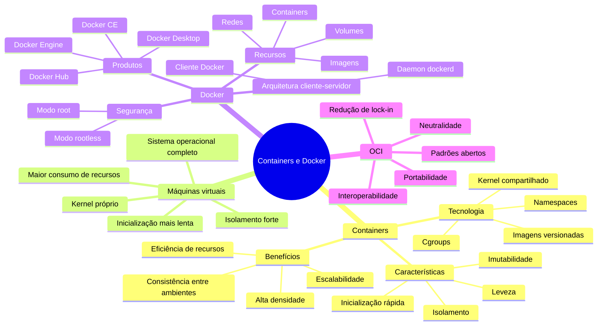

# Introdução aos Containers e Docker

## Resumo

Um container é uma unidade padronizada de software que empacota o código e todas as suas dependências, permitindo que uma aplicação seja executada de forma rápida e consistente em qualquer ambiente. Isso significa que, independentemente do sistema operacional ou das configurações específicas do host, o container fornecerá um ambiente isolado e consistente para a aplicação.

## Mapa mental

## O que são containers

Containers são ambientes isolados que reúnem uma aplicação e tudo o que ela precisa para funcionar. Dessa forma, a aplicação mantém um comportamento consistente nos diferentes ambientes em que é executada.

### Principais características dos containers

- **Imutabilidade:** containers são construídos a partir de imagens que são essencialmente snapshots imutáveis. Isso garante que o ambiente de execução seja o mesmo em qualquer lugar em que o container seja implantado.
- **Isolamento de processos e recursos computacionais:** cada container opera em um espaço de usuário isolado, com seu próprio sistema de arquivos, rede e recursos de processamento. Isso permite que múltiplos containers sejam executados simultaneamente sem interferência mútua.
- **Leveza:** ao contrário das máquinas virtuais, os containers são executados como processos no sistema operacional do host, sem a necessidade de um sistema operacional completo para cada instância. Isso resulta em menor uso de recursos e maior eficiência.
- **Utilização dos recursos do kernel do SO:** containers compartilham o kernel do sistema operacional do host. Eles não necessitam de um sistema operacional completo em cada instância, o que reduz significativamente o overhead.
- **Ilusão de SO próprio:** por meio de tecnologias como namespaces e cgroups, o container é "enganado" para acreditar que possui seu próprio sistema operacional completo, com recursos e processos independentes.
- **Visibilidade limitada de processos:** um container só pode ver e interagir com processos dentro do seu próprio espaço. Isso aumenta a segurança e o isolamento entre aplicações.
- **Inicialização rápida:** como não há necessidade de inicializar um sistema operacional completo, os containers podem ser iniciados e parados quase instantaneamente, facilitando a escalabilidade e a implantação contínua.
- **Utilização de imagens imutáveis:** containers são criados a partir de imagens que definem o estado inicial do sistema de arquivos. Essas imagens são imutáveis e podem ser versionadas, garantindo consistência entre ambientes.
- **Predominância no Linux:** embora existam implementações de containers em outros sistemas operacionais, a maioria das tecnologias de containerização, incluindo o Docker, foi inicialmente desenvolvida para o Linux, aproveitando recursos nativos do kernel.
- **Fim do “na minha máquina funciona”:** com containers, o clássico problema de discrepâncias entre ambientes de desenvolvimento e produção é mitigado, já que o ambiente dentro do container é o mesmo em qualquer máquina.

## Containers vs. máquinas virtuais

| Característica | Máquinas virtuais (VMs) | Containers |
|---|---|---|
| Sistema operacional | Cada VM executa um sistema operacional completo, incluindo seu próprio kernel. | Compartilham o kernel do sistema operacional do host. |
| Recursos | Consomem mais memória e CPU devido à virtualização do hardware e ao SO completo. | São mais leves e eficientes, pois isolam somente a aplicação e suas dependências. |
| Inicialização | Pode levar minutos, de forma semelhante à inicialização de um computador físico. | Ocorre em segundos ou até milissegundos. |
| Isolamento | Forte, pois cada VM é completamente separada das demais e do host. | Isolamento de aplicações por meio de tecnologias como namespaces e cgroups. |
| Densidade | Menor quantidade de instâncias por host. | Permitem executar um grande número de instâncias em um único host. |

### Máquinas virtuais (VMs)

- **Sistema operacional completo:** cada VM executa um sistema operacional completo, incluindo seu próprio kernel, sobre um hypervisor que gerencia os recursos do hardware físico.
- **Overhead maior:** devido à necessidade de virtualizar todo o hardware e executar um SO completo, as VMs consomem mais recursos de memória e CPU.
- **Tempo de inicialização mais longo:** inicializar uma VM é similar a ligar um computador físico, o que pode levar minutos.
- **Isolamento forte:** oferecem um alto nível de isolamento, já que cada VM é completamente separada das demais e do host.

### Containers

- **Compartilhamento do kernel do host:** containers utilizam o kernel do sistema operacional do host, isolando apenas o aplicativo e suas dependências.
- **Leveza e eficiência:** sem a necessidade de virtualizar o hardware ou executar um SO completo, os containers são significativamente mais leves e eficientes.
- **Inicialização instantânea:** containers podem ser iniciados em segundos ou até milissegundos, permitindo rápida escalabilidade.
- **Isolamento de aplicativos:** embora compartilhem o kernel do host, os containers ainda oferecem isolamento suficiente para a maioria das aplicações, graças a tecnologias como namespaces e cgroups.
- **Alta densidade:** devido à sua leveza, é possível executar um grande número de containers em um único host, maximizando o uso dos recursos disponíveis.

## Docker como container runtime

### História do Docker

- **Origem:** o Docker foi criado em 2013 por uma empresa chamada dotCloud, que oferecia serviços de Plataforma como Serviço (PaaS). Inicialmente, o Docker foi desenvolvido para uso interno, visando facilitar a implantação de aplicações.
- **Open source:** reconhecendo o potencial da tecnologia, a dotCloud tornou o Docker Engine open source, permitindo que a comunidade contribuísse e expandisse suas capacidades.
- **Evolução para Docker Inc.:** com a crescente popularidade do Docker, a dotCloud mudou seu foco principal para o desenvolvimento e suporte da tecnologia Docker, renomeando-se como Docker Inc.

### Docker Engine, Docker CE e Docker Desktop

- **Docker Engine:** é o coração do Docker, responsável por criar, gerenciar e executar containers. Ele é composto pelo daemon Docker (`dockerd`) e pela interface de linha de comando (CLI).
- **Docker CE (Community Edition):** é a versão gratuita e open source do Docker Engine, destinada a desenvolvedores e pequenas equipes.
- **Docker Desktop:** é um produto da Docker Inc. que fornece um ambiente completo de desenvolvimento Docker para macOS e Windows. Inclui o Docker Engine, Docker CLI, Docker Compose e outras ferramentas.
- **Diferença entre Docker CE/Engine e Docker Desktop:** enquanto o Docker CE/Engine é a tecnologia-base para criação e execução de containers, o Docker Desktop oferece uma interface integrada e fácil de usar para desenvolvedores em ambientes não Linux, além de incluir recursos adicionais.

### Funcionamento do Docker

- **Utilização de recursos do Linux:** o Docker aproveita funcionalidades nativas do kernel Linux, como namespaces e cgroups, para fornecer isolamento e gerenciamento de recursos aos containers.
- **Ferramenta 360°:** além de gerenciar containers, o Docker oferece funcionalidades para gerenciamento de redes, volumes (discos) e criação de imagens, tornando-se uma solução completa para ambientes containerizados.

#### Arquitetura cliente-servidor

- **Daemon Docker:** o `dockerd` é o daemon executado em segundo plano, responsável por gerenciar containers, imagens, redes e volumes.
- **Cliente Docker:** é a interface de linha de comando (CLI) com a qual os usuários interagem para enviar comandos ao daemon.
- **Ponto único de falha (SPoF):** como o daemon Docker gerencia todos os containers, se ele falhar, todos os containers no host podem ser afetados. Isso torna o daemon um ponto único de falha que deve ser considerado em ambientes críticos.

#### Root vs. rootless

- **Modo root:** por padrão, o daemon Docker requer privilégios de root para executar, o que pode representar riscos de segurança.
- **Modo rootless:** o Docker também pode ser executado em modo rootless, permitindo que usuários não privilegiados executem containers sem acesso root, aumentando a segurança.

### Observações sobre a Docker Inc.

- **Contribuição para a comunidade:** a Docker Inc. tem sido fundamental na popularização dos containers e continua contribuindo com projetos open source.
- **Modelos de negócio:** além das versões gratuitas, a Docker Inc. oferece soluções comerciais com suporte empresarial e recursos avançados.
- **Ecossistema rico:** a empresa mantém o Docker Hub, um repositório público de imagens Docker, e desenvolve ferramentas adicionais que complementam o Docker Engine.

## Open Container Initiative (OCI)

A Open Container Initiative (OCI) é um projeto colaborativo aberto, fundado em 2015 pela Docker Inc. e outras empresas líderes na indústria de tecnologia. O objetivo principal da OCI é criar padrões abertos para formatos de containers e runtimes, garantindo a portabilidade e a interoperabilidade entre diferentes plataformas e ferramentas.

### Principais objetivos da OCI

- **Estabelecer padrões:** definir especificações padronizadas para formatos de imagens de containers e runtimes, promovendo um ecossistema unificado.
- **Interoperabilidade:** permitir que containers criados em uma plataforma possam ser executados em outra sem modificações significativas.
- **Neutralidade:** garantir que os padrões não sejam controlados por uma única entidade, mas pela comunidade e pela indústria como um todo.

### Importância da OCI

- **Evitar lock-in:** com padrões abertos, desenvolvedores e empresas não ficam presos a uma única ferramenta ou fornecedor.
- **Facilitar a inovação:** ao estabelecer bases comuns, a OCI permite que diferentes projetos e ferramentas inovem sobre os padrões, beneficiando todo o ecossistema.
- **Adoção ampla:** muitas das principais tecnologias de containerização, incluindo Docker e Kubernetes, aderem aos padrões da OCI, promovendo compatibilidade.

## Conclusão

Os containers revolucionaram a forma como desenvolvemos, implantamos e executamos aplicações, oferecendo consistência, eficiência e escalabilidade. O Docker desempenhou um papel crucial nessa transformação, fornecendo ferramentas acessíveis e poderosas para trabalhar com containers. Com a padronização promovida pela Open Container Initiative, o futuro dos containers promete ser ainda mais integrado e interoperável, permitindo que desenvolvedores e empresas aproveitem ao máximo essa tecnologia em constante evolução.

## Referências

- [Docker Documentation](https://docs.docker.com/)
- [Open Container Initiative](https://opencontainers.org/)
- [Docker — What is a container?](https://www.docker.com/resources/what-container/)
