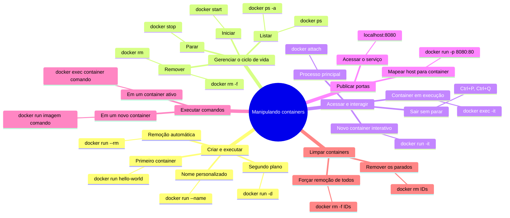

# Manipulando containers com Docker

Este guia apresenta os principais comandos para criar, executar, acessar, parar e remover containers Docker.

## Mapa mental



## 1. Executando o primeiro container

Para verificar se o Docker está instalado corretamente, execute:

```bash
docker run hello-world
```

Esse comando baixa a imagem `hello-world`, caso ela ainda não esteja no sistema, e executa um container que exibe uma mensagem de confirmação.

## 2. Nomeando containers e entendendo diferentes execuções

### Executando um container com nome personalizado

Por padrão, o Docker atribui nomes aleatórios aos containers. Para especificar um nome, utilize a opção `--name`:

```bash
docker run --name mynginx nginx
```

### Executando um container em segundo plano

Para executar um container no modo *detached* — em segundo plano — utilize a opção `-d`:

```bash
docker run -d --name mynginx nginx
```

### Mapeando portas

Para mapear uma porta do container para uma porta do host, utilize a opção `-p`:

```bash
docker run -d -p 8080:80 nginx
```

Nesse exemplo, a porta `80` do container é mapeada para a porta `8080` do host.

## 3. Listando, parando, iniciando e removendo containers

### Listando containers

Para listar apenas os containers em execução:

```bash
docker ps
```

Para listar todos os containers, incluindo os que estão parados:

```bash
docker ps -a
```

> `docker ps` lista somente os containers em execução, enquanto `docker ps -a` lista todos os containers existentes no sistema.

### Parando um container

```bash
docker stop mynginx
```

### Iniciando um container parado

```bash
docker start mynginx
```

### Removendo um container

Para remover normalmente um container parado:

```bash
docker rm mynginx
```

Para forçar a remoção de um container em execução:

```bash
docker rm -f mynginx
```

> `docker rm` remove somente containers parados. Para remover um container em execução, utilize `docker rm -f`.

## 4. Attach e detach

### Conectando-se a um container em execução

```bash
docker attach mynginx
```

O comando `docker attach` conecta o terminal ao processo principal do container.

### Saindo sem parar o container

Para sair do modo *attach* sem interromper o container, pressione:

```text
Ctrl+P, Ctrl+Q
```

## 5. Executando comandos em containers

### Executando um comando em um novo container

É possível executar um comando diretamente ao criar um container:

```bash
docker run nginx ls -la
```

Esse exemplo executa `ls -la` no novo container baseado na imagem `nginx` e exibe o resultado no terminal.

### Entrando em um novo container com Bash

Para iniciar um novo container e abrir uma sessão interativa do Bash:

```bash
docker run -it nginx bash
```

### Diferença entre `docker run` e `docker exec`

| Comando | Comportamento |
|---|---|
| `docker run` | Cria e inicia um novo container. |
| `docker exec` | Executa um novo comando em um container que já está em execução. |

Para abrir uma sessão Bash no container `mynginx` já em execução:

```bash
docker exec -it mynginx bash
```

### Removendo o container automaticamente

A opção `--rm` remove automaticamente o container quando sua execução termina:

```bash
docker run --rm nginx ls -la
```

## 6. Removendo vários containers

### Removendo todos os containers parados

```bash
docker rm $(docker ps -a -q)
```

Nesse comando:

- `docker ps -a -q` retorna somente os IDs de todos os containers;
- `$(...)` insere essa lista de IDs no comando `docker rm`.

### Removendo todos os containers, inclusive os que estão em execução

```bash
docker rm -f $(docker ps -a -q)
```

> **Atenção:** esse comando força a remoção de todos os containers existentes, inclusive aqueles que estão em execução.

## 7. Publicação de portas

Para executar um servidor Nginx em segundo plano e publicar sua porta:

```bash
docker run -d -p 8080:80 nginx
```

Depois disso, o Nginx estará acessível em [http://localhost:8080](http://localhost:8080).

O formato do mapeamento é:

```text
-p <porta-do-host>:<porta-do-container>
```

## 8. Execução interativa e acesso ao shell

Se o container já estiver em execução, acesse seu shell com:

```bash
docker exec -it mynginx bash
```

### Diferença entre `docker exec` e `docker attach`

| Comando | Comportamento |
|---|---|
| `docker exec` | Inicia um novo processo dentro do container, como uma nova sessão Bash. |
| `docker attach` | Anexa o terminal ao processo principal do container, permitindo, por exemplo, acompanhar sua saída em tempo real. |

## Resumo dos comandos

### Executar um container

```bash
docker run [opções] imagem [comando]
```

### Listar containers

```bash
docker ps       # Containers em execução
docker ps -a    # Todos os containers
```

### Parar, iniciar e remover containers

```bash
docker stop <nome|id>
docker start <nome|id>
docker rm <nome|id>
docker rm -f <nome|id>    # Remoção forçada
```

### Executar comandos em um container

```bash
docker exec -it <nome|id> <comando>
```

### Acessar o Bash

```bash
docker exec -it <nome|id> bash
```

### Remover todos os containers

```bash
docker rm $(docker ps -a -q)
docker rm -f $(docker ps -a -q)    # Inclui containers em execução
```
