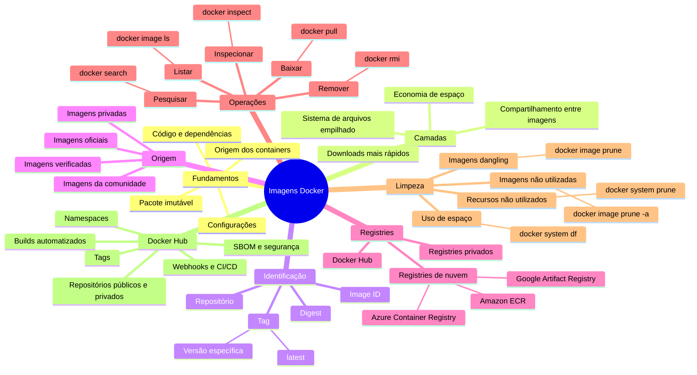

# Imagens Docker

Este guia apresenta os conceitos fundamentais das imagens Docker e os principais comandos para pesquisar, baixar, listar, inspecionar e remover imagens.

## Mapa mental



## 1. O que são imagens Docker?

Uma imagem Docker é um pacote imutável que contém os elementos necessários para executar uma aplicação, como:

- código;
- bibliotecas e dependências;
- ferramentas do sistema;
- configurações;
- instruções de inicialização.

A imagem funciona como um modelo para a criação de containers. Um container é uma instância executável de uma imagem e recebe sua própria camada de leitura e escrita.

## 2. Camadas das imagens

As imagens Docker são compostas por camadas empilhadas. Ao criar uma imagem com um `Dockerfile`, as instruções que alteram seu sistema de arquivos produzem novas camadas.

Essas camadas podem ser compartilhadas entre diferentes imagens. Se duas imagens utilizam a mesma camada base, o Docker precisa armazená-la e baixá-la apenas uma vez, economizando espaço e tempo.

As camadas da imagem são somente leitura. Alterações realizadas durante a execução são armazenadas na camada gravável do container, não na imagem original.

## 3. Nome, tag e identificação

Uma referência de imagem pode conter registry, namespace, repositório e tag:

```text
<registry>/<namespace>/<repositorio>:<tag>
```

Exemplo:

```text
docker.io/usuario/minha-aplicacao:1.0
```

- **Repositório:** identifica a imagem, como `nginx`.
- **Tag:** normalmente identifica uma versão ou variação, como `1.21`.
- **Image ID:** identificador local do conteúdo da imagem.
- **Digest:** identificador imutável calculado a partir do conteúdo.

Quando a tag não é informada, o Docker utiliza `latest` por padrão. Para ter execuções previsíveis, prefira informar uma tag específica em vez de depender de `latest`.

## 4. Origem das imagens

### Imagens oficiais

São imagens selecionadas e mantidas dentro do programa de imagens oficiais. Geralmente utilizam nomes sem namespace, como:

```text
nginx
redis
mysql
```

### Imagens verificadas

São publicadas por fornecedores ou organizações que passaram pelo processo de verificação da plataforma utilizada.

### Imagens da comunidade ou de terceiros

São criadas por usuários e organizações. Normalmente incluem um namespace:

```text
usuario/imagem-personalizada
```

Antes de utilizar uma imagem de terceiros, verifique o mantenedor, a documentação, a frequência de atualização e as informações de segurança disponíveis.

## 5. Listagem e inspeção

### Listar imagens locais

```bash
docker images
```

A forma equivalente na CLI agrupada é:

```bash
docker image ls
```

A saída apresenta informações como:

- `REPOSITORY`: nome do repositório;
- `TAG`: versão ou variação da imagem;
- `IMAGE ID`: identificador local;
- `CREATED`: data de criação;
- `SIZE`: tamanho ocupado pela imagem.

### Filtrar imagens

Utilize `--filter` ou `-f` para restringir a listagem. O exemplo abaixo mostra imagens anteriores à imagem de referência:

```bash
docker images --filter before=nginx:1.19
```

### Inspecionar uma imagem

```bash
docker inspect <nome-ou-id>
```

Exemplo:

```bash
docker inspect nginx
```

O comando retorna um documento JSON com informações como tags, camadas, variáveis de ambiente, comando de entrada e volumes declarados.

### Retornar um campo específico

A opção `--format` utiliza templates Go para selecionar informações da saída:

```bash
docker inspect --format '{{.Id}}' nginx
```

Esse exemplo retorna somente o ID da imagem `nginx`.

## 6. Registries e download de imagens

Um registry é um serviço utilizado para armazenar e distribuir imagens de containers. Alguns exemplos são:

- Docker Hub;
- Amazon Elastic Container Registry (ECR);
- Google Artifact Registry;
- Azure Container Registry (ACR);
- registries privados mantidos por empresas.

### Pesquisar no Docker Hub

```bash
docker search <termo>
```

Exemplo:

```bash
docker search ubuntu
```

### Baixar uma imagem

```bash
docker pull <nome>:<tag>
```

Exemplos:

```bash
docker pull nginx
docker pull nginx:1.21
```

Também é possível identificar exatamente o conteúdo desejado utilizando um digest:

```bash
docker pull <nome>@<digest>
```

### Diferença entre `docker pull` e `docker run`

| Comando | Comportamento |
|---|---|
| `docker pull` | Baixa a imagem sem criar um container. |
| `docker run` | Cria e inicia um container; se a imagem não estiver disponível localmente, tenta baixá-la antes. |

Exemplo:

```bash
docker run nginx
```

## 7. Remoção de imagens

### Remover uma imagem

```bash
docker rmi <nome-ou-id>
```

Exemplo:

```bash
docker rmi nginx
```

Também é possível utilizar:

```bash
docker image rm nginx
```

Uma imagem normalmente não pode ser removida enquanto estiver referenciada por um container, inclusive um container parado. Nesse caso, remova primeiro o container que mantém a associação.

### Remover várias imagens

```bash
docker rmi imagem1 imagem2 imagem3
```

### Tentar remover todas as imagens locais

No Bash ou PowerShell:

```bash
docker rmi $(docker images -q)
```

> **Atenção:** o comando tenta remover todas as imagens retornadas. Imagens vinculadas a containers podem gerar erros e permanecer no ambiente.

## 8. Limpeza e uso de espaço

### Remover imagens sem tag

O comando abaixo remove imagens *dangling*, que não possuem tag e não são referenciadas:

```bash
docker image prune
```

### Remover todas as imagens não utilizadas

```bash
docker image prune -a
```

> **Atenção:** `-a` remove todas as imagens que não estejam associadas a containers, e não apenas as imagens *dangling*. Elas precisarão ser baixadas novamente caso voltem a ser utilizadas.

### Consultar o uso de espaço

```bash
docker system df
```

Esse comando resume o espaço utilizado por imagens, containers, volumes locais e cache de build.

### Limpar recursos não utilizados

```bash
docker system prune
```

O comando remove recursos não utilizados, como containers parados, redes sem uso, imagens *dangling* e cache de build.

Para incluir volumes não utilizados na limpeza:

```bash
docker system prune --volumes
```

> **Atenção:** revise a lista apresentada pelo Docker antes de confirmar uma operação de limpeza, principalmente quando utilizar `-a` ou `--volumes`.

## 9. Docker Hub

O Docker Hub é um registry público utilizado para armazenar, encontrar e distribuir imagens.

### Conta e namespace

Ao criar uma conta, o usuário recebe um namespace que funciona como prefixo para seus repositórios:

```text
joaosilva/minha-imagem
```

### Tags

Um mesmo repositório pode possuir várias tags para representar versões ou variações:

```text
nginx:1.21
nginx:alpine
```

### Repositórios públicos e privados

- **Públicos:** podem ser encontrados e baixados publicamente.
- **Privados:** exigem autenticação e são usados para imagens internas ou restritas.

### Segurança e SBOM

Uma SBOM (*Software Bill of Materials*) descreve os componentes e dependências contidos em uma imagem. Quando disponível, ela auxilia na análise de vulnerabilidades, licenças e riscos da cadeia de suprimentos.

### Automação e integração

Registries podem oferecer recursos como:

- builds automatizados a partir de repositórios de código;
- webhooks para notificar sistemas externos;
- integração com pipelines de CI/CD;
- histórico de builds e gerenciamento de tags.

## Boas práticas

- Prefira imagens oficiais ou publicadas por mantenedores confiáveis.
- Utilize tags específicas para evitar mudanças inesperadas.
- Verifique a documentação e as atualizações da imagem.
- Evite imagens desnecessariamente grandes.
- Analise vulnerabilidades e a SBOM quando essas informações estiverem disponíveis.
- Execute limpezas com cautela para não remover imagens ou volumes importantes.

## Resumo dos comandos

| Objetivo | Comando |
|---|---|
| Listar imagens | `docker image ls` |
| Filtrar imagens | `docker images --filter <filtro>` |
| Pesquisar no Docker Hub | `docker search <termo>` |
| Baixar uma imagem | `docker pull <imagem>:<tag>` |
| Inspecionar uma imagem | `docker inspect <imagem>` |
| Obter um campo da inspeção | `docker inspect --format '{{.<campo>}}' <imagem>` |
| Remover uma imagem | `docker rmi <imagem>` |
| Remover imagens sem tag | `docker image prune` |
| Remover imagens não utilizadas | `docker image prune -a` |
| Consultar o uso de espaço | `docker system df` |
| Limpar recursos não utilizados | `docker system prune` |
