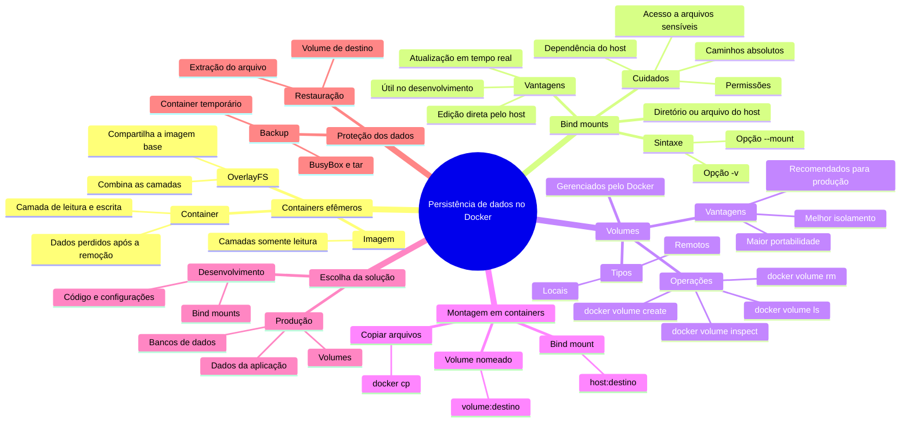

# Volumes e Bind Mounts no Docker

Este guia explica por que os dados de um container são efêmeros e apresenta duas formas de persistência no Docker: **volumes** e **bind mounts**.

## Mapa mental



## 1. Natureza efêmera dos containers

Por padrão, as alterações realizadas no sistema de arquivos de um container ficam vinculadas àquele container. Quando ele é removido, os dados gravados em sua camada de escrita também são perdidos.

Esse comportamento ajuda a manter os containers consistentes e descartáveis, mas exige uma estratégia de persistência para dados como:

- informações armazenadas por bancos de dados;
- logs importantes;
- arquivos enviados por usuários;
- conteúdos gerados pela aplicação.

### Camadas de leitura e escrita

As imagens Docker são formadas por camadas somente leitura. Ao iniciar um container, o Docker adiciona sobre elas uma camada gravável própria do container.

- **Camadas da imagem:** são somente leitura e podem ser compartilhadas por vários containers.
- **Camada do container:** recebe as alterações feitas durante a execução.
- **OverlayFS:** combina essas camadas e as apresenta como um único sistema de arquivos.

Como cada container possui sua própria camada gravável, vários containers podem utilizar a mesma imagem sem interferir diretamente uns nos outros.

## 2. Formas de persistência

### Volumes

Os volumes são gerenciados pelo Docker e armazenados em uma área própria do sistema:

- não dependem de um caminho específico escolhido pelo usuário no host;
- podem utilizar drivers locais ou remotos;
- facilitam backup e migração;
- são geralmente a opção recomendada para dados persistentes em produção.

### Bind mounts

Um bind mount associa um arquivo ou diretório existente no host a um caminho dentro do container:

- permite editar diretamente os arquivos pelo host;
- é útil durante o desenvolvimento;
- depende da estrutura de diretórios e das permissões do host;
- pode reduzir a portabilidade entre ambientes.

## 3. Bind mounts

### Sintaxe com `-v`

```bash
docker run -v <caminho-do-host>:<caminho-do-container> <imagem>
```

### Sintaxe com `--mount`

```bash
docker run --mount type=bind,source=<caminho-do-host>,target=<caminho-do-container> <imagem>
```

A opção `--mount` é mais explícita e costuma facilitar a leitura de comandos maiores.

### Exemplo: Nginx com bind mount

#### 1. Criar o diretório no host

No Bash:

```bash
mkdir -p ~/my_nginx_html
```

No PowerShell:

```powershell
New-Item -ItemType Directory -Force ./my_nginx_html
```

#### 2. Criar o arquivo `index.html`

No Bash:

```bash
echo "<h1>Hello Docker!</h1>" > ~/my_nginx_html/index.html
```

No PowerShell:

```powershell
Set-Content ./my_nginx_html/index.html '<h1>Hello Docker!</h1>'
```

#### 3. Executar o Nginx

No Bash:

```bash
docker run -d --name meu-nginx -p 8080:80 -v "$(pwd)/my_nginx_html:/usr/share/nginx/html" nginx
```

No PowerShell:

```powershell
docker run -d --name meu-nginx -p 8080:80 -v "${PWD}/my_nginx_html:/usr/share/nginx/html" nginx
```

O diretório `my_nginx_html` do host será montado sobre `/usr/share/nginx/html` no container.

#### 4. Verificar o conteúdo

Acesse [http://localhost:8080](http://localhost:8080). A página deverá exibir **Hello Docker!**.

### Alterar o conteúdo pelo host

No Bash:

```bash
echo "<h1>Content Updated!</h1>" > ~/my_nginx_html/index.html
```

No PowerShell:

```powershell
Set-Content ./my_nginx_html/index.html '<h1>Content Updated!</h1>'
```

Ao atualizar o navegador, a alteração será exibida pelo Nginx sem a necessidade de recriar a imagem.

### Demonstrar a persistência

Remova o container:

```bash
docker rm -f meu-nginx
```

Recrie-o utilizando o mesmo diretório do host:

```bash
docker run -d --name meu-nginx -p 8080:80 -v "$(pwd)/my_nginx_html:/usr/share/nginx/html" nginx
```

O conteúdo continuará disponível porque os arquivos estão armazenados no host, fora da camada gravável do container.

### Demonstrar a efemeridade sem o bind mount

Remova o container e crie outro sem montar o diretório:

```bash
docker rm -f meu-nginx
docker run -d --name meu-nginx -p 8080:80 nginx
```

Ao acessar novamente [http://localhost:8080](http://localhost:8080), será exibido o conteúdo original da imagem Nginx, e não o arquivo armazenado no host.

### Cuidados com bind mounts

- Prefira caminhos absolutos para evitar ambiguidades.
- Confirme que o Docker possui permissão para acessar o diretório.
- Tenha cuidado ao montar diretórios sensíveis do host.
- Considere as diferenças de caminhos entre Linux, macOS e Windows.

## 4. Gerenciamento de volumes

### Criar um volume

```bash
docker volume create my_volume
```

### Listar os volumes

```bash
docker volume ls
```

### Inspecionar um volume

```bash
docker volume inspect my_volume
```

Alguns campos importantes da saída são:

- `Mountpoint`: local em que o Docker armazena os dados;
- `Driver`: driver utilizado pelo volume, normalmente `local`;
- `Labels`: metadados associados ao volume;
- `Name`: nome do volume;
- `Scope`: escopo no qual o volume está disponível.

Exemplo simplificado:

```json
[
  {
    "CreatedAt": "2023-10-10T12:34:56Z",
    "Driver": "local",
    "Labels": {},
    "Mountpoint": "/var/lib/docker/volumes/my_volume/_data",
    "Name": "my_volume",
    "Options": {},
    "Scope": "local"
  }
]
```

### Remover um volume

```bash
docker volume rm my_volume
```

> O Docker não remove um volume que está sendo utilizado por um container. Além disso, remover um volume exclui os dados armazenados nele.

### Tipos de volumes

- **Locais:** armazenados no host e gerenciados pelo Docker.
- **Remotos:** usam drivers para integrar serviços como NFS, Azure Files ou AWS EFS.

## 5. Montar um volume em um container

### 1. Executar o Nginx com o volume

```bash
docker run -d --name nginx-volume -p 8081:80 -v my_volume:/usr/share/nginx/html nginx
```

Também é possível utilizar a sintaxe explícita:

```bash
docker run -d --name nginx-volume -p 8081:80 --mount type=volume,source=my_volume,target=/usr/share/nginx/html nginx
```

### 2. Copiar um arquivo para o container

No Bash:

```bash
docker cp ~/my_nginx_html/index.html nginx-volume:/usr/share/nginx/html/index.html
```

No PowerShell:

```powershell
docker cp ./my_nginx_html/index.html nginx-volume:/usr/share/nginx/html/index.html
```

Como o destino está associado ao volume, o arquivo permanecerá armazenado mesmo após a remoção do container.

### 3. Verificar no navegador

Acesse [http://localhost:8081](http://localhost:8081).

### 4. Remover e recriar o container

```bash
docker rm -f nginx-volume
docker run -d --name nginx-volume -p 8081:80 -v my_volume:/usr/share/nginx/html nginx
```

Ao acessar novamente a porta `8081`, o conteúdo continuará disponível no volume.

## 6. Volumes ou bind mounts?

| Característica | Volumes | Bind mounts |
|---|---|---|
| Gerenciamento | Realizado pelo Docker | Realizado pelo usuário no host |
| Caminho no host | Controlado pelo Docker | Escolhido explicitamente |
| Portabilidade | Maior | Depende da estrutura do host |
| Isolamento | Maior | Dá acesso direto a arquivos do host |
| Uso comum | Bancos de dados e produção | Código-fonte e desenvolvimento |
| Drivers remotos | Suportados | Não se aplicam |
| Edição direta pelo host | Menos conveniente | Simples e imediata |

### Quando utilizar volumes

- Dados de bancos de dados e aplicações.
- Ambientes de produção.
- Situações em que é desejável maior independência do host.
- Armazenamento remoto ou em rede por meio de drivers.

### Quando utilizar bind mounts

- Desenvolvimento local com atualização de arquivos em tempo real.
- Compartilhamento de configurações ou arquivos específicos do host.
- Casos em que o usuário precisa controlar diretamente o local dos dados.

## 7. Backup e restauração de volumes

Os exemplos a seguir utilizam um container temporário baseado na imagem `busybox`.

### Criar o backup

No Bash:

```bash
docker run --rm -v my_volume:/data -v "$(pwd):/backup" busybox tar czf /backup/backup.tar.gz -C /data .
```

No PowerShell:

```powershell
docker run --rm -v my_volume:/data -v "${PWD}:/backup" busybox tar czf /backup/backup.tar.gz -C /data .
```

O comando:

1. monta `my_volume` em `/data`;
2. monta o diretório atual do host em `/backup`;
3. compacta o conteúdo de `/data` no arquivo `backup.tar.gz`;
4. remove o container temporário após a conclusão por causa de `--rm`.

### Restaurar o backup

Certifique-se de que o volume de destino exista e esteja vazio antes da restauração:

```bash
docker volume create my_volume
```

No Bash:

```bash
docker run --rm -v my_volume:/data -v "$(pwd):/backup" busybox tar xzf /backup/backup.tar.gz -C /data
```

No PowerShell:

```powershell
docker run --rm -v my_volume:/data -v "${PWD}:/backup" busybox tar xzf /backup/backup.tar.gz -C /data
```

Esse comando extrai o conteúdo do arquivo de backup diretamente no volume montado em `/data`.

## Resumo de comandos

| Objetivo | Comando |
|---|---|
| Criar um volume | `docker volume create <volume>` |
| Listar volumes | `docker volume ls` |
| Inspecionar um volume | `docker volume inspect <volume>` |
| Remover um volume | `docker volume rm <volume>` |
| Usar um volume | `docker run -v <volume>:<destino> <imagem>` |
| Usar um bind mount | `docker run -v <host>:<destino> <imagem>` |
| Usar bind mount com `--mount` | `docker run --mount type=bind,source=<host>,target=<destino> <imagem>` |
| Copiar um arquivo para o container | `docker cp <origem> <container>:<destino>` |
